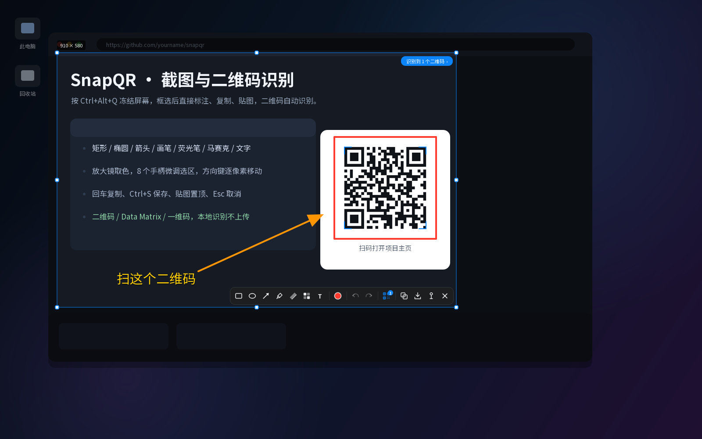
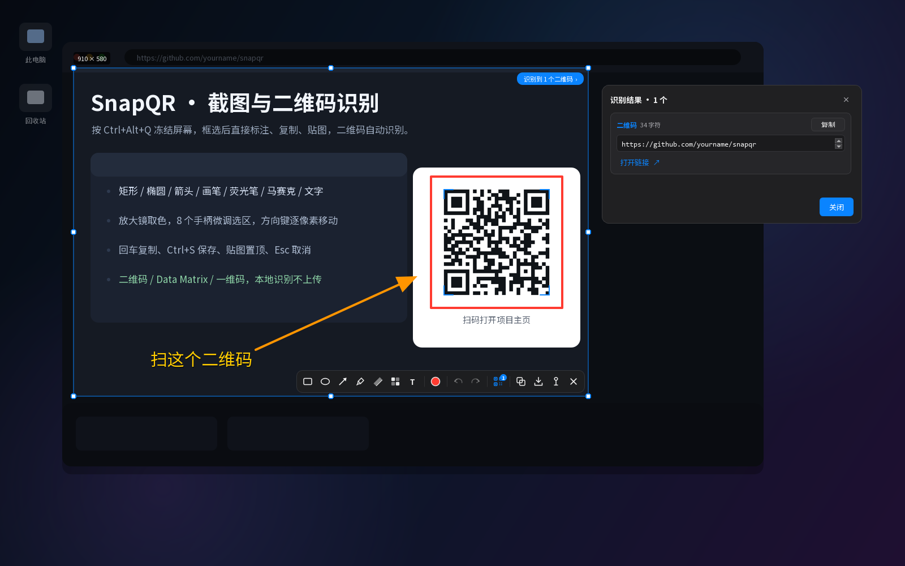

<div align="center">


# SnapQR

**Windows 11 上的截图 + 标注 + 二维码识别小工具**

按一下快捷键冻结屏幕，框选、标注、复制、保存、贴图，
选区里的二维码会自动识别出来——全程本地处理，不联网。

[](https://www.python.org/)
[]()
[](LICENSE)
[]()

</div>



## 功能

- **像 QQ 截图一样顺手**：全局快捷键冻结屏幕、框选、8 个手柄微调、方向键逐像素移动，带放大镜和取色。
- **单击选中整个窗口**：鼠标悬停时高亮窗口，点一下就把整个窗口框进来（不是手动拖）。
- **7 种标注**：矩形、椭圆、箭头、画笔、荧光笔、马赛克、文字；支持撤销 / 重做、颜色和线宽。
- **二维码 / 条形码识别**：框选后自动识别，也可以点工具栏按钮手动识别；识别结果可以复制、打开链接。
- **贴图置顶**：把截图钉在屏幕上，可拖动、滚轮缩放、右键再复制或另存。
- **多显示器**：所有屏幕拼成一张虚拟桌面，选区可以跨屏。
- **托盘常驻**：单实例运行、全局快捷键、开机自启、深色界面，关闭窗口不会退出。

<div align="center">

</div>

## 快速开始

### 方式一：下载 exe（推荐给普通用户）

到 [Releases](../../releases) 下载 `SnapQR.exe`，双击运行即可。
首次启动后会常驻系统托盘，按 `Ctrl + Alt + Q` 截图。

> exe 由 PyInstaller 打包、未做代码签名，Windows SmartScreen 可能提示"未知发布者"，选择"更多信息 → 仍要运行"即可。

### 方式二：从源码运行

需要 **Windows 10/11 + Python 3.10+**。

```powershell
git clone https://github.com/<your-name>/snapqr.git
cd snapqr

py -3 -m venv .venv
.\.venv\Scripts\Activate.ps1        # 如果提示禁止运行脚本：
                                    # Set-ExecutionPolicy -Scope Process Bypass
pip install -r requirements.txt
python -m snapqr
```

或者直接双击 `start.bat`：它会优先使用项目里的 `.venv`，用 `pythonw` 启动，不显示控制台窗口。

启动后程序**没有主窗口**，只会在托盘里出现一个蓝色图标：

- 按 `Ctrl + Alt + Q` 开始截图
- 或右键托盘图标 → 「截图」
- 右键托盘图标 → 「设置…」可以改快捷键、保存目录等

## 使用方法

| 操作 | 说明 |
| --- | --- |
| `Ctrl + Alt + Q` | 开始截图（默认快捷键，可在设置里修改） |
| 拖动鼠标 | 框选任意区域 |
| 单击窗口 | 直接选中鼠标下整个窗口 |
| 拖动 8 个手柄 | 调整选区大小；拖动选区内部可整体移动 |
| 方向键 / `Shift` + 方向键 | 选区移动 1px / 10px |
| `Ctrl + A` | 选中整个屏幕 |
| `R` `O` `A` `P` `H` `M` `T` | 依次切换矩形、椭圆、箭头、画笔、荧光笔、马赛克、文字 |
| `Ctrl + Z` / `Ctrl + Y` | 撤销 / 重做 |
| `Enter` 或 `Ctrl + C` | 复制到剪贴板并退出 |
| 双击选区 | 同上，复制并退出 |
| `Ctrl + S` | 保存为 PNG / JPEG |
| `Esc` | 先取消选区，再按一次退出截图 |
| 右键 | 退出截图 |

工具栏从左到右依次是：7 种标注工具、颜色 / 线宽、撤销、重做、**识别二维码**、复制、保存、贴图、关闭。

### 二维码识别

识别有三种入口：

1. **自动识别**（默认开启）：框选完成后自动在选区里找二维码，找到会在右上角出现「识别到 N 个二维码」提示，二维码四角也会标出蓝色框；点提示或工具栏的二维码按钮查看结果。
2. **手动识别**：点工具栏上的二维码图标，或点右上角提示条。
3. **剪贴板识别**：右键托盘图标 → 「识别剪贴板图片中的二维码」。

识别结果面板会列出每个码的格式和内容，支持：

- 一键复制单条 / 全部
- 内容是网址时显示「打开链接」
- 多个二维码时用列表展示
- 中文、UTF-8 内容正常显示

识别基于 [zxing-cpp](https://github.com/zxing-cpp/zxing-cpp)，支持二维码、Micro QR、Data Matrix、Aztec、PDF417，以及 Code 128 / 39 / 93、EAN-13 / 8、UPC、ITF、Codabar 等一维码。**所有识别都在本机完成，不会上传任何图片。**

### 贴图窗口

点工具栏的图钉按钮，截图会变成一个小窗口钉在屏幕上：

- 拖动移动，滚轮缩放
- 双击或按 `Esc` 关闭
- 右键菜单：复制图片 / 保存图片 / 恢复 100% 大小 / 关闭

## 设置

右键托盘图标 → 「设置…」，可以修改：

| 设置项 | 默认值 | 说明 |
| --- | --- | --- |
| 截图快捷键 | `Ctrl + Alt + Q` | 修改后立即重新注册；与 QQ / 微信冲突时会提示 |
| 显示放大镜与取色 | 开 | 框选时显示像素放大、HEX 颜色 |
| 悬停选中窗口 | 开 | 单击直接选中整个窗口 |
| 保存后复制到剪贴板 | 开 | 保存文件时同时复制图片 |
| 保存目录 | `图片\SnapQR` | 也可以点「默认」恢复 |
| 自动识别二维码 | 开 | 框选完成后自动识别 |
| 只识别到一个结果时自动复制 | 关 | 适合经常扫单个码的场景 |
| 开机自启 | 关 | 写入当前用户的 `Run` 注册表项 |

配置文件在 `%APPDATA%\SnapQR\config.json`，纯 JSON，可以直接编辑；日志在 `%APPDATA%\SnapQR\snapqr.log`。

## 打包成 exe

```powershell
.\build.ps1
# 产物：dist\SnapQR.exe
```

`build.ps1` 会自动创建 `.venv`、安装依赖并调用 PyInstaller。
如果 PowerShell 提示「禁止运行脚本」，改用：

```powershell
powershell -ExecutionPolicy Bypass -File .\build.ps1
```

或者直接双击 `build.bat`（内部已经带上 `-ExecutionPolicy Bypass`）。
国内网络慢可以加镜像：

```powershell
.\build.ps1 -IndexUrl https://pypi.tuna.tsinghua.edu.cn/simple
```

手动打包：

```powershell
pip install -r requirements-dev.txt
python -m PyInstaller --noconfirm --clean SnapQR.spec
```

仓库内置 GitHub Actions：推送到 `main` 会跑测试并产出 `SnapQR.exe` 构建产物；打 `v*` 标签会自动把 exe 附到 Release。

## 项目结构

```text
SnapQR/
├─ snapqr/
│  ├─ __main__.py       # 命令行入口
│  ├─ app.py            # 托盘、单实例、截图流程装配
│  ├─ overlay.py        # 全屏遮罩：选区、放大镜、标注交互
│  ├─ toolbar.py        # 浮动工具栏 + 颜色/线宽浮层
│  ├─ annotations.py    # 标注数据模型与绘制
│  ├─ render.py         # 截图 + 标注合成导出
│  ├─ capture.py        # 多显示器桌面捕获与坐标换算
│  ├─ qrdecode.py       # 二维码识别（zxing-cpp 为主，OpenCV/pyzbar 兜底）
│  ├─ qrpanel.py        # 识别结果面板
│  ├─ pinwindow.py      # 贴图窗口
│  ├─ settingsdialog.py # 设置界面
│  ├─ hotkey.py         # Windows 全局快捷键
│  ├─ winutil.py        # Win32 小工具（窗口枚举、自启、前台激活）
│  ├─ geometry.py       # 选区手柄 / 工具栏摆放的纯函数
│  ├─ icons.py          # 纯代码绘制的矢量图标（无图片资源）
│  ├─ theme.py          # 配色与字体
│  ├─ toast.py          # 轻提示
│  └─ config.py         # 配置读写
├─ tests/               # pytest：几何、渲染、识别、交互、配置
├─ tools/               # 图标与演示图生成脚本
├─ assets/              # 应用图标
├─ docs/                # README 演示图
├─ SnapQR.pyw           # 双击启动（无控制台）
├─ start.bat            # 启动脚本
├─ build.ps1            # 一键打包
├─ build.bat            # 一键打包（绕过执行策略）
├─ SnapQR.spec          # PyInstaller 配置
└─ pyproject.toml
```

## 开发与测试

```powershell
pip install -r requirements-dev.txt

# 单元测试（离屏运行，不会弹窗）
python -m pytest -q

# 打包后的冒烟自检：连开/关三次识别结果面板，回归崩溃问题
python -m snapqr --self-test

# 重新生成 README 演示图（离屏渲染，不会截取真实桌面）
python tools/make_demo.py

# 重新生成 assets/icon.ico
python tools/make_icon.py
```

测试覆盖了选区几何、手柄缩放、标注导出、二维码解码（含中文）、快捷键解析、配置校验，以及用 Qt 事件模拟的框选 / 绘制 / 文字输入流程。

演示图是用 `QT_QPA_PLATFORM=offscreen` 渲染的合成桌面，不含任何真实屏幕内容。

## 常见问题

**按快捷键没反应？**
可能被 QQ、微信、Snipaste 等占用了同一个组合。右键托盘图标 → 设置，换一个组合（例如 `Ctrl + Alt + Q` 或 `Ctrl + Shift + X`）；也可以直接从托盘菜单截图。

**截图是黑的 / 截不到某些窗口？**
独占全屏游戏、开启 HDR 的视频、部分 DRM 播放器受 Windows 保护，无法用常规方式截取。把游戏改成无边框窗口、关闭 HDR 通常可以解决。

**多显示器缩放比例不一样时，画面有点糊？**
目前按主显示器的缩放比例合成整张虚拟桌面，副屏缩放比例不同时会被轻微重采样。把各屏缩放设成一致即可获得像素级精确的截图。

**识别不出二维码？**
框选范围稍微放大一点，让二维码四周留出白边；太模糊、太小或被标注遮住的码识别率会下降。也可以试试用「识别剪贴板图片」放大截图后再识别。

**杀毒软件报毒？**
PyInstaller 打包的未签名 exe 常见误报。介意的话直接源码运行，或把 exe 加入白名单。

**托盘图标不见了？**
Windows 11 默认会折叠托盘图标，点任务栏上的 `^` 把它拖到外面固定即可。

## 已知限制

- 暂不支持滚动长截图、OCR 文字识别。
- 「选中窗口」只到顶层窗口粒度，不识别窗口内部的子控件。
- 混合 DPI 多屏下按主屏缩放合成，副屏可能有轻微缩放。
- 仅支持 Windows 10/11，未适配 macOS / Linux。

## 上传到 GitHub

```powershell
cd snapqr
git init
git add .
git commit -m "feat: SnapQR 1.0.0 截图 + 二维码识别"
git branch -M main
git remote add origin https://github.com/<your-name>/snapqr.git
git push -u origin main
```

推一个标签即可触发自动打包并发布 Release：

```powershell
git tag v1.0.0
git push origin v1.0.0
```

`.venv/`、`dist/`、`__pycache__/` 等已经在 `.gitignore` 里排除了。

## 许可证

[MIT](LICENSE)

第三方组件：[PySide6](https://www.qt.io/qt-for-python)（LGPLv3）、[zxing-cpp](https://github.com/zxing-cpp/zxing-cpp)（Apache-2.0）。
